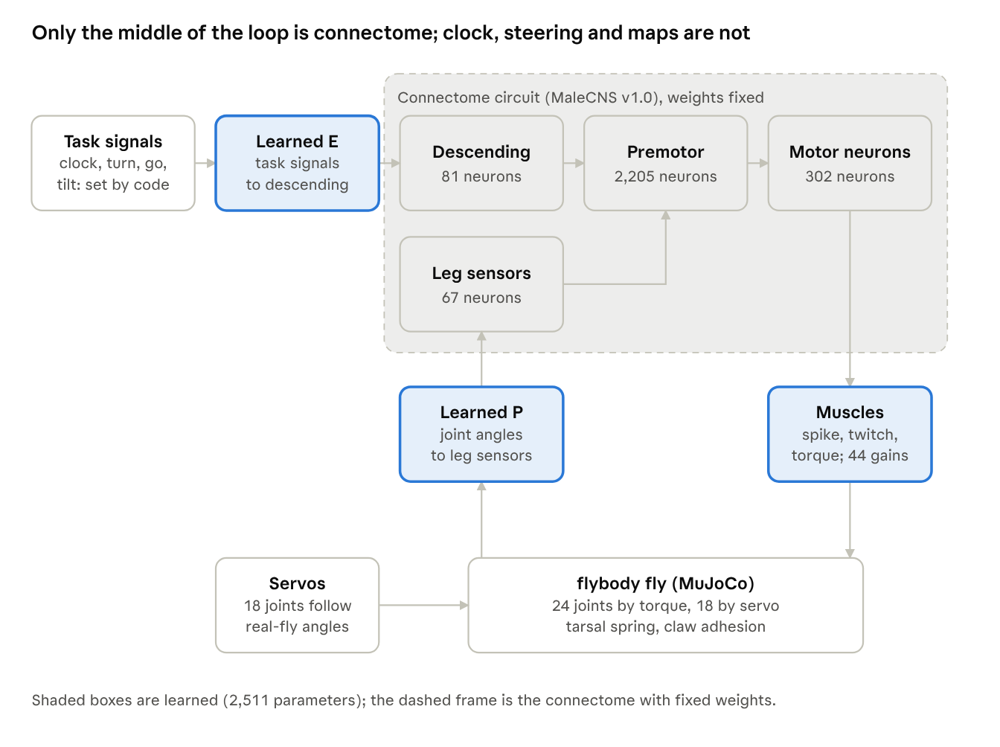

# How to Train your Fly

A fixed-weight circuit from the male fly connectome (MaleCNS v1.0) walks the
[flybody](https://github.com/TuragaLab/flybody) fruit fly to targets with a gait learned from real
flies: **12 of 12 new targets reached, no falls**. Only the circuit's input and output maps are trained;
every one of its 82,836 connections keeps its connectome weight.



- **Circuit:** 2,655 MaleCNS neurons (81 descending, 2,205 premotor, 302 leg motor neurons, 67 leg
  proprioceptors), graded rate units, weights = sign × synapses / the receiving neuron's total input.
- **Body:** flybody in MuJoCo. Motor-neuron spikes → muscle twitches → joint torque ("option 5") on the 24
  coxa / femur / tibia / tarsus joints; 18 twist / abduction joints follow the real gait by servo.
- **Gait:** fitted from flybody's motion capture of real walking flies (9.5 Hz strides, 1.73 cm/s).
- **Training:** imitation of a real-gait controller (BPTT), then CMA-ES in simulation (targets, falls,
  joint-angle realism), then a command-following fine-tune so another network can drive the walker.

Full write-up: [docs/REPORT.md](docs/REPORT.md).

## Install

```bash
conda env create -f environment.yml
conda activate how-to-train-your-fly
```

The fly model comes from flybody's assets. Either install flybody
(`pip install --no-deps git+https://github.com/TuragaLab/flybody.git`, only its `fruitfly/assets` are used) or
clone it and point at the assets:

```bash
git clone https://github.com/TuragaLab/flybody.git third_party/flybody      # or anywhere, then:
export FLYBODY_ASSETS=$PWD/third_party/flybody/flybody/fruitfly/assets
```

Results here were produced with flybody commit `d015e9b` (fruitfly.xml sha256 `d14946fd…`).

## Quick start (trained networks are included)

```bash
cd walk
python walk_real_gui.py                                   # interactive viewer
python walk_real.py eval runs_real/cma_robust/policy.npz --n 12 --ms 6000
python walk_real_cmd.py eval runs_real/cmd2/policy.npz    # open-loop command following
```

## Reproduce everything

The connectome-derived circuit (`walk/walk_circuit/`) and the gait model (`walk/real_gait.npz`) are
committed, so steps 1-2 are only needed to rebuild them. Data downloads: [data/README.md](data/README.md).

```bash
cd walk
# 1. circuit from MaleCNS v1.0 (3 flat files, ~1.1 GB)
python prepare_connectome.py                 # -> data/processed/{neurons,connectivity}.feather
python walk_circuit_build.py                 # -> walk_circuit/
# 2. real gait from flybody's walking motion capture
python real_gait.py                          # -> real_gait.npz
# 3. training
python walk_real.py teacher                  # the real-gait teacher (8/8 targets)
python walk_real.py imitate --rounds 0       # imitation          -> runs_real/imitate/
python walk_real.py train --gens 80          # CMA-ES round 1     -> runs_real/cma/
python walk_real.py train --start runs_real/cma/policy.npz --gens 60 --targets 4 --ms 4000 \
       --sigma 0.02 --realism 12 --out cma_robust                       # round 2
python walk_real_cmd.py train --gens 80      # command following  -> runs_real/cmd/
python walk_real_cmd.py train --start runs_real/cmd/policy.npz --gens 60 --episodes 3 \
       --go-levels 0.5,0.75,1 --out cmd2                                 # round 2
```

CMA-ES uses one process per CPU core (`--workers`); imitation uses a CUDA GPU if available.
Verified in this repo: the committed circuit rebuilds byte-identical from the raw MaleCNS files, the gait
model refits to within 1e-14, and `eval` of `runs_real/cma_robust` reproduces the reported 12/12 exactly.

## Layout

| Path | What |
|---|---|
| `walk/paths.py` | data locations (override with `MALECNS_DIR`, `FLY_DATA_DIR`, `FLYBODY_WALKING_DATA`, `FLYBODY_ASSETS`) |
| `walk/fly_body.py` | the option-5 body model, joint sign probe, shared constants |
| `walk/prepare_connectome.py` | MaleCNS flat files → neuron and connectivity tables |
| `walk/walk_circuit_build.py` | the 2,655-neuron walking circuit → `walk/walk_circuit/` |
| `walk/real_gait.py` | real gait model from motion capture → `walk/real_gait.npz` |
| `walk/walk_real.py` | brain, body, real-gait teacher, imitation, CMA-ES, evaluation |
| `walk/walk_real_cmd.py` | command-following fine-tune and its evaluation |
| `walk/walk_real_gui.py` | interactive viewer with a real-fly ghost |
| `walk/runs_real/*/policy.npz` | trained networks: `imitate`, `cma`, `cma_robust` (default), `cmd`, `cmd2` |
| `docs/` | report and figures |

## Data and credits

- **MaleCNS v1.0** connectome (Janelia FlyEM): not included; download per [data/README.md](data/README.md) and
  follow its terms of use and citation request. `walk/walk_circuit/` is derived from it.
- **flybody** (Vaxenburg et al., *Whole-body physics simulation of fruit fly locomotion*, Nature 2025): body
  model and walking motion-capture dataset (figshare doi:10.25378/janelia.25309105). Not included.
