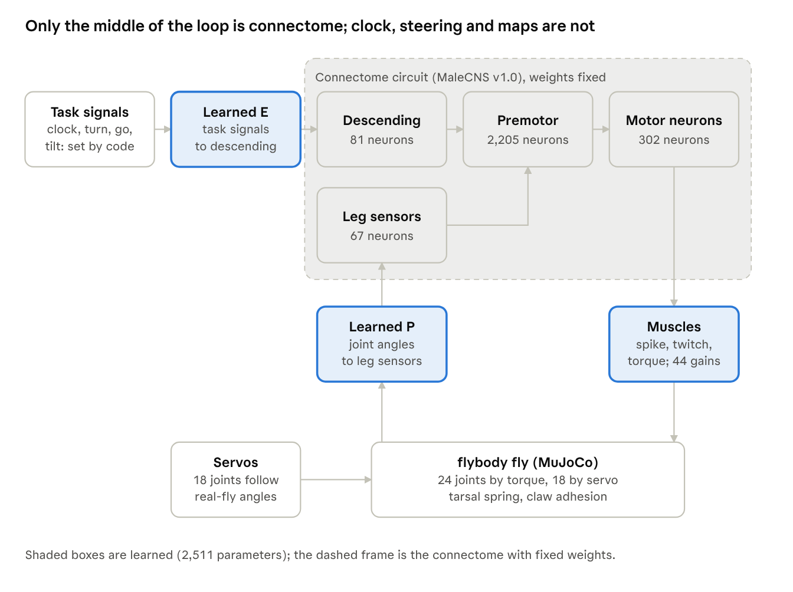
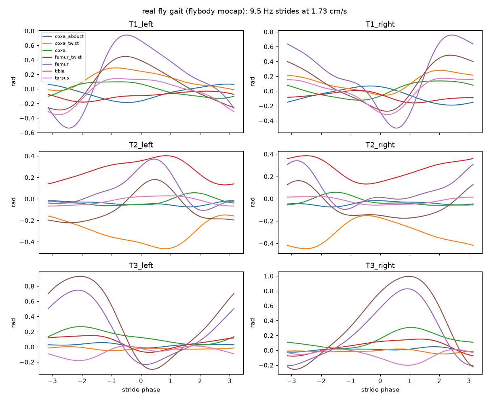

# Training a connectome-driven fly to walk with a real fly's gait

## Summary

A fixed-weight circuit from the male fly connectome (MaleCNS v1.0) walks the flybody fruit fly to targets
with a gait learned from real flies: 12 of 12 new targets reached, no falls. Only the circuit's input and
output maps were trained; every one of its 82,836 connections keeps its connectome weight.

- **Body:** the flybody MuJoCo fly. Motor-neuron spikes become muscle twitches and then joint torque
  ("option 5"); there are no position servos on the 24 driven leg joints.
- **Gait:** fitted from flybody's motion-capture dataset of real walking flies: 9.5 Hz strides at 1.73 cm/s,
  tripod coordination.
- **Training:** the network first copied a controller that tracks the real gait, then CMA-ES tuned it in
  simulation to reach targets, stay upright and stay close to the real joint angles.
- **Command following:** a later fine-tune made the walker follow any (go, turn) command open-loop, with 0 of
  180 capsizes, so another network can drive it.

Main caveats: the stride rhythm and the steering decision come from outside the connectome, 18 of the 42 leg
joints are servo-driven, and the trained posture is about 20° (RMS) from the real fly's.

## Background and goal

The goal was a walking fly whose legs are moved only by a connectome circuit, and whose gait looks like a real
fly's.

- **flybody** (Vaxenburg et al., Nature 2025) is an anatomically detailed fruit-fly body in MuJoCo. Its own
  walking policy is an artificial network trained to imitate motion capture of real flies.
- **MaleCNS v1.0** is the complete male central nervous system connectome, including the ventral nerve cord
  that drives the legs.
- **The approach follows our earlier fly_arm project:** keep the connectome weights fixed, learn only how task
  signals enter the circuit and how motor neurons drive the body, and train with CMA-ES in simulation.

A first version (`walk_trained`, not in this repo) learned a hand-made tripod gait. It reached 11 of 12
targets but looked stiff: 18 of the 42 leg joints were held fixed, and body tilt was about 18°. This report
covers the second version (`walk_real`), which learns real fly walking, as flybody does.

## Methods

The walker is a connectome circuit with learned input and output maps, driving option-5 muscles, trained first
by imitation of a real-gait controller and then by CMA-ES.

Commands enter through a learned map, pass through the fixed connectome circuit, and leave as muscle torque;
leg sensors close the loop through a second learned map.

### Walking circuit

| Population | Neurons | How selected |
| --- | --- | --- |
| Descending (command) | 81 | largest reach onto each leg's motor neurons, plus known walking types (DNa01/02, DNg100, MDN, DNb05/06) |
| Premotor interneurons | 2,205 | at least 1% of some leg motor neuron's input |
| Leg motor neurons | 302 | the 24 joints the body model can drive (coxa, femur, tibia, tarsus × 6 legs) |
| Leg proprioceptors | 67 | strongest inputs into the circuit, 12 per leg |

The circuit has 82,836 connections. Weights are sign × synapses / the receiving neuron's total input, with
signs from predicted neurotransmitter. Units are graded rate neurons with a 2 ms time constant; 10 ms made the
reflex loops too slow (the fly fell in 4 of 4 tests).

### Learned parts (2,511 parameters)

- **E:** task signals → the 81 descending neurons. Task signals are a stride clock (harmonics 1-3), turn, go
  and body tilt.
- **P:** each leg's joint angles and velocities → that leg's proprioceptors.
- **Gains:** one output gain per motor pool (44), and one recurrent gain.

### Body: option-5 muscles

Each motor neuron fires at up to 300 Hz in proportion to its drive. Every spike adds a muscle twitch (3 ms
rise, 20 ms decay), and joint torque = sign × Tmax × (extensor activation − flexor activation). Claw adhesion
follows the tarsal depressor motor neurons. The physics runs at 0.1 ms, the network at 1 ms.

### Real gait from motion capture

From flybody's walking dataset (100 clips, 73 s at 500 frames/s), every leg joint was fitted as a Fourier
series in stride phase, with terms for yaw rate and speed. Stride phase came from the claws' fore-aft motion;
56 s of coordinated walking were used. Fits explain 30-80% of each joint's variance. Real flies in the data
stride at 9.5 Hz at a median 1.73 cm/s.

### Real-gait teacher and body fixes

The teacher tracks the real joint angles with muscle drive (gain 4, damping 0.05), keeps the body level, and
grips with the claws in stance. Three fixes were needed:

- **Servo joints:** coxa abduction, coxa twist and femur twist (18 joints) have no motor neurons in the
  connectome table, so they follow the real gait by position servo.
- **Tarsal spring:** the connectome table has no tarsal levator motor neurons on the middle and hind legs. A
  passive elastic return keeps those tarsi from folding (joint error to the real fly fell from 0.28 to 0.07 rad).
- **Turning:** the gait model's yaw term is scaled to about 115°/s, with real slower-walking kinematics in
  sharp turns. Without it the fly circled targets behind it.

### Training

1. **Imitation:** the network was fitted by backpropagation through time to reproduce the teacher's motor drive
   (79 s of teacher data, 1,500 iterations).
2. **CMA-ES round 1:** 80 generations of 22 candidates, scored on progress to targets, falls, tilt, and joint
   error to the real fly (weight 4).
3. **CMA-ES round 2:** 60 generations, 4 targets × 4 s per candidate, joint-error weight 12.
4. **Command-following fine-tune:** two further CMA-ES rounds (80 and 60 generations) scored on held random
   (go, turn) commands: yaw tracking, speed, falls and realism. Round 2 added intermediate go levels.

## Results

The trained network reaches every new target without falling. Its posture is still about 20° (RMS) from the
real fly's, against 4° for the teacher.

### Reaching targets

Targets 1.5-2 cm away in new directions, 6 s per attempt.

| Controller | Targets reached | Falls | Joint error vs real fly (RMS) | Body tilt |
| --- | --- | --- | --- | --- |
| Real-gait teacher (no network) | 8 / 8, in 1.0-2.6 s | 0 | 0.07 rad (4°) | 5° |
| Network, imitation only | 0 / 4 | 2 | — | 9° |
| Network + CMA-ES round 1 | 12 / 12 | 0 | 0.41 rad | 8° |
| **Network + CMA-ES round 2** | **12 / 12**, in 1.5-4.3 s | **0** | **0.35 rad (20°)** | **13°** |
| For comparison: hand-made tripod network (`walk_trained`) | 11 / 12 | 0 | — | 18° |

The teacher walks at 1.4-1.5 cm/s with a 9.5 Hz stride, close to the real flies' 1.73 cm/s. Most of the
network's joint error is constant posture offsets on a few joints (middle-right coxa, front tarsi), not wrong
timing.

### Following commands open-loop

The target test steers closed-loop, which kept the turn command near ±1 almost all the time. Driven open-loop
with fixed commands (20 episodes per condition, 4 s), the round-2 network was only well behaved at turn = ±1.
The command-following fine-tune fixed that.

| | Before fine-tune (`cma_robust`) | After fine-tune (`cmd2`) |
| --- | --- | --- |
| Capsizes, 180 episodes | 19.4% | **0%** |
| Yaw at turn −1 / 0 / +1 (°/s, + = left) | +85 / +76 / −92 | +38 / +15 / −25 |
| Correct turn direction at ±0.5 | no | yes |
| Speed at go 0.5 / 0.75 / 1 (cm/s) | 0.19 / 0.30 / 0.70 | 0.11 / 0.48 / 0.66 |
| Closed-loop targets reached | 12 / 12 in 6 s | 12 / 12 in 12 s (7 / 12 in 6 s) |

The cost is gentler turning (about ±25-38°/s, a turn radius of about 0.8 cm) and a slight left drift at turn 0.

### What did not work

- **DAgger** (the network walks, the teacher labels its states, refit): targets reached fell to 0 of 6, with
  2-5 falls and joint error 0.5-0.65 rad. Gradient refitting undid what CMA-ES had tuned.
- **Poisson motor spikes:** the network was trained with regular spikes and falls when spikes are random.
- **A heavier realism weight** in CMA-ES round 2 (12 vs 4) only reduced joint error from 0.41 to 0.35 rad, and
  tilt rose.

## Interactive viewer

`walk/walk_real_gui.py` shows the trained network walking in real time next to a translucent real-fly ghost,
so the remaining realism gap is visible directly.

- **3D view:** live MuJoCo rendering; follow, close, side, low "legs" and top-down cameras; red posts for
  targets and an orange trail.
- **Real-fly ghost:** a translucent fly beside or overlaid on the model. Its legs follow the motion-capture gait
  at the same stride phase and turn.
- **Map:** click to send the fly to a target, Shift-click to add waypoints; straight 3 cm runs at 0° or ±45°.
- **Plots:** motor-neuron spikes for the last 500 ms; one leg's joint angles, model (solid) vs real fly
  (dashed); activity of the descending, premotor and motor layers.
- **Status:** speed, stride rate, and joint error to the real fly (RMS over 42 joints).
- **Controllers:** the round-2 network, the round-1 network, imitation only, or the real-gait teacher.
- **Speed:** real time, half, quarter, or slow motion (1/10).

The simulation runs at about 1× real time on one CPU core.

## Limitations

The connectome turns externally supplied rhythm and steering commands into motor neuron activity; it does not
generate the walk on its own.

| Part of the walk | Where it comes from |
| --- | --- |
| Where to go (turn toward the target) | Code: heading error × gain |
| Stride rhythm (9.5 Hz) | Code: an external clock of sine waves |
| What the descending neurons receive | Learned matrix E |
| What the proprioceptors receive | Learned matrix P |
| Motor pool drive strength | 44 learned gains |
| Descending → premotor → motor neurons | **Connectome**, weights fixed |
| 18 of 42 leg joints | Position servos replaying real-fly kinematics |
| Mid / hind tarsus return | Passive spring in the body model |
| The gait pattern | Copied from the real-gait teacher, then tuned by CMA-ES |

Further limits:

- **Wiring specificity untested.** With 2,511 learned parameters around the circuit, a shuffled-weight network
  of the same size might walk as well. No shuffled control has been run.
- **Realism gap:** joint angles are about 20° (RMS) from the real fly's, against 4° for the teacher. Body tilt
  is 13°.
- **Turning beyond the data:** the scaled yaw term (about 115°/s for the teacher) extrapolates past most of the
  recorded turns.
- **Model simplifications:** graded rate neurons rather than spikes inside the circuit; signs from predicted
  neurotransmitter; only direct (one-step) premotor inputs to the motor neurons; male connectome in a
  female-based body model.
- **Regular spikes only:** the network falls with Poisson motor spikes.
- **Small motion-capture sample:** the gait was fitted from the 100-clip subset (73 s) of the dataset, not the
  full 6.4 GB set.

## Next steps

The most important open test is a shuffled-connectome control: the same training on degree-preserving
shuffled weights.

- [ ] Shuffled-connectome control (does the real wiring walk better?)
- [ ] Close the posture gap: per-joint error in the CMA-ES score, longer runs from round 2
- [ ] Refit the gait from the full motion-capture dataset
- [ ] Train with Poisson spikes, adding the noise gradually
- [ ] Move steering into the network (give it the target direction instead of a turn signal)

Commands to reproduce every step are in the [README](../README.md).
